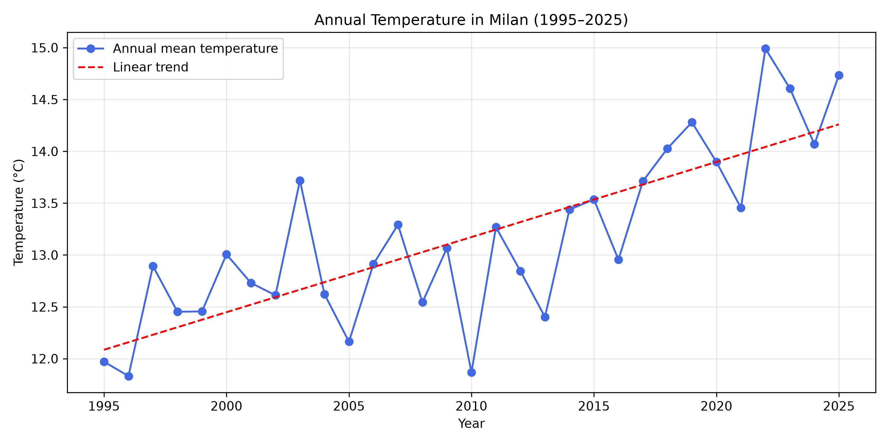

# 🌤️ Milan Weather Trends

Milan Weather Trends is a Python-based data analysis project that explores historical temperature patterns in Milan, Italy, from **1995 to 2025**. It uses real historical weather data to investigate temperature changes, seasonal patterns, and the frequency of hot days.


## What the project does

The project performs five main analyses:

| **Analysis** | **What it does** |
|---|---|
| Annual temperatures | Calculates yearly average temperatures and identifies the warmest and coldest years. |
| Monthly temperatures | Examines seasonal temperature patterns across the twelve months. |
| Temperature trends | Estimates long-term temperature changes using NumPy linear regression. |
| Hot days | Counts days with maximum temperatures of at least 30°C for each year. |
| Historical comparison | Compares average temperatures between 1995–2004 and 2016–2025. |

### How the temperature trend works

The project estimates the linear temperature trend using `numpy.polyfit()`:

\[
T(y) = my + b
\]

Where `m` represents the annual temperature change and `b` is the intercept.

The slope is multiplied by 10 to express the estimated temperature change in **°C per decade**.

The calculation is implemented in `src/analysis.py`.

## Data sources

- **[Open-Meteo Historical Weather API](https://open-meteo.com/en/docs/historical-weather-api):** Provides historical daily mean and maximum temperature estimates for Milan.
- **`data/milan_weather.csv`:** Locally stored dataset containing observations from January 1995 to December 2025.

The data loader downloads the dataset when the local CSV file is unavailable.

## Libraries

| **Library** | **Used for** |
|---|---|
| `requests` | Retrieving historical weather data from the API |
| `pandas` | Data cleaning, grouping, and aggregation |
| `numpy` | Statistical calculations and linear regression |
| `matplotlib` | Temperature charts and heatmaps |
| `jupyter` | Interactive analysis and presentation |

Dependencies are listed in `requirements.txt`.

## Setup

1. Clone the repository:

   ```bash
   git clone https://github.com/noorfarhana878-rgb/weather-trends-milan.git
   cd weather-trends-milan
   ```

2. Create and activate a virtual environment:

   ```bash
   python3 -m venv .venv
   source .venv/bin/activate
   ```

   On Windows, use `.venv\Scripts\activate`.

3. Install the required libraries:

   ```bash
   python -m pip install -r requirements.txt
   ```

No API key is required.

## Run

Run the complete analysis from the project folder:

```bash
python main.py
```

The script downloads or loads weather data, performs statistical analysis, generates visualizations, and exports results to the `outputs/` folder.

### The Jupyter Notebook

`notebooks/weather_analysis.ipynb` demonstrates the project step by step, including data collection, cleaning, statistical analysis, and visualizations.

Start Jupyter from the project folder:

```bash
jupyter notebook
```

Open `notebooks/weather_analysis.ipynb` and run all cells.

The notebook imports reusable functions from the `src/` package rather than duplicating the analysis code.

## Project structure

```text
weather-trends-milan/
├── main.py                       # Main execution script
├── src/                          # Reusable Python modules
│   ├── __init__.py
│   ├── data_loader.py            # API requests and CSV loading
│   ├── data_processing.py        # Data cleaning and validation
│   ├── analysis.py               # Statistical calculations
│   └── visualization.py          # Charts and heatmaps
├── data/
│   └── milan_weather.csv         # Historical weather dataset
├── notebooks/
│   └── weather_analysis.ipynb    # Step-by-step analysis
├── outputs/                      # Generated charts and CSV results
├── .gitignore
├── requirements.txt
└── README.md
```

All files in `src/` contain reusable Python functions that can be imported into the Jupyter Notebook or executed through `main.py`.

## Results

The project generates annual temperature trends, monthly temperature comparisons, a year-by-month heatmap, and annual hot-day counts.

The visualizations and statistical results are available in the `outputs/` folder and the Jupyter Notebook.

### Annual Temperature Trend



---

**Course:** Coding for Data Science and Data Management  
**University:** University of Milan  
**Academic Year:** 2026/27
